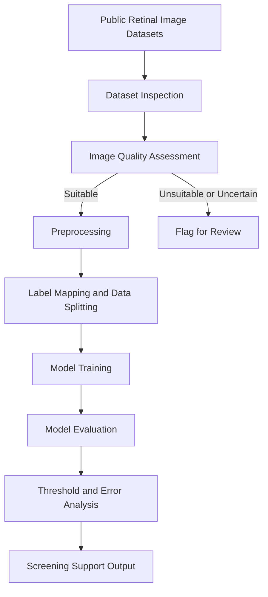

# RetinaSense🔬

**AI-Assisted Diabetic Retinopathy Screening Through Computer Vision**

RetinaSense is a machine learning research project exploring how computer vision can help identify retinal images that may show signs of diabetic retinopathy (DR). Our goal is to investigate an accessible first-pass screening pipeline that flags potentially referable cases for further professional evaluation.

> **Our goal:** Make preliminary retinal screening more accessible while keeping clinical decisions in the hands of qualified healthcare professionals.

---

## 📌 Table of Contents

- [About the Project](#-about-the-project)
- [Problem Statement](#-problem-statement)
- [Our Approach](#-our-approach)
- [ML Pipeline](#-ml-pipeline)
- [Datasets](#-datasets)
- [Technical Approach](#-technical-approach)
- [Current Work](#-current-work)
- [Team](#-team)
- [Evaluation Strategy](#-evaluation-strategy)
- [Roadmap](#-roadmap)
- [Medical Disclaimer](#-medical-disclaimer)
- [References](#-references)

---

## 🧠 About the Project

Diabetic retinopathy is a complication of diabetes that damages the blood vessels in the retina. It can progress without noticeable symptoms, making regular screening important for detecting potential problems early.

However, access to screening remains uneven, particularly in rural and underserved communities where specialist appointments, transportation, and distance can create barriers.

RetinaSense explores whether machine learning can help make the initial screening process more accessible by analyzing retinal fundus photographs and flagging images that may require further review.

### Why RetinaSense?

- **Accessibility:** Explore screening workflows for settings with limited access to specialists.
- **Early identification:** Flag images that may show signs of referable diabetic retinopathy.
- **Reliability:** Investigate image quality, class imbalance, and model generalization.
- **Responsible AI:** Prioritize sensitivity and professional review over unsupported diagnostic claims.

## 🎯 Problem Statement

How can we develop and evaluate a computer vision pipeline that identifies retinal fundus images potentially showing referable diabetic retinopathy, while accounting for image quality, class imbalance, false negatives, and generalization across datasets?

## 💡 Our Approach

We plan to investigate a binary classification task:

- **Referable DR:** Images meeting the selected reference-label definition for referable diabetic retinopathy.
- **Non-referable DR:** Images below that reference-label threshold.

The precise mapping from original severity grades to these categories will be documented before training.

Our initial experiments will compare a baseline convolutional neural network (CNN) against a transfer-learning model such as ResNet.

Rather than treating every prediction as definitive, the pipeline will investigate how uncertain predictions and unsuitable images can be flagged for additional review.

## 🔬 ML Pipeline

### Pipeline stages

| Stage | Purpose |
|---|---|
| Dataset inspection | Understand labels, class distributions, metadata, and dataset limitations. |
| Image quality assessment | Identify images that may be unsuitable for reliable model input. |
| Preprocessing | Standardize image dimensions and pixel representation while preserving relevant retinal features. |
| Label preparation | Map original severity grades to the selected binary classification task. |
| Model training | Train a baseline CNN and evaluate a transfer-learning approach. |
| Evaluation | Measure performance, inspect false negatives, and assess generalization. |
| Screening support | Explore flagging potentially referable or uncertain cases for professional review. |

## 🗂️ Datasets

We are investigating publicly available datasets for model development and evaluation.

| Dataset | Intended use | Initial considerations |
|---|---|---|
| APTOS 2019 | Primary development and benchmarking | Five severity grades; inspect class distribution and image quality. |
| EyePACS | Additional training or external evaluation | Check label compatibility, dataset size, and potential overlap with other datasets. |
| MESSIDOR | External evaluation candidate | Verify grading conventions and compatibility with the selected referable DR definition. |
| OLIVES | Exploratory generalization analysis | Investigate available labels, imaging modalities, and suitability for the task. |

Dataset roles are preliminary and will be finalized after inspecting the available images, labels, and licensing conditions.

### Dataset inspection checklist

- [ ] Confirm dataset access, licensing, and permitted use.
- [ ] Count images and labels in each dataset.
- [ ] Inspect the distribution of original severity grades.
- [ ] Check for missing, inconsistent, or ambiguous labels.
- [ ] Inspect image dimensions, color channels, and file formats.
- [ ] Investigate duplicate images and potential patient overlap.
- [ ] Define a consistent referable DR label mapping.
- [ ] Determine appropriate training, validation, and test splits.

## ⚙️ Technical Approach

### Image preprocessing

We will investigate a consistent preprocessing strategy for retinal fundus images.

Areas to explore:
- Standardizing image dimensions and color representation.
- Comparing resizing, cropping, and retinal-region extraction.
- Preserving retinal structures and lesions that may be relevant to classification.
- Normalizing pixel values consistently.
- Applying augmentation only to training data when appropriate.

### Image quality assessment

We will investigate how to identify images that may not be suitable for reliable classification.

Areas to explore:
- Illumination and exposure.
- Blur and focus.
- Occlusion and visible retinal area.
- Image resolution and artifacts.
- Criteria for flagging uncertain or unsuitable images.

Quality thresholds will be selected and validated rather than assumed in advance.

### Class imbalance

We will inspect the original severity-grade distribution and the final binary-label distribution.

Potential approaches include:
- Class-weighted loss functions.
- Training-only oversampling.
- Carefully selected data augmentation.
- Threshold adjustment using validation data.

We will compare these approaches based on their effect on sensitivity, precision, and overall model performance.

### Model development

Initial model candidates:
1. Baseline CNN.
2. Transfer-learning model such as ResNet.

We will establish a reproducible baseline before exploring more complex architectures.

## 📊 Evaluation Strategy

We will evaluate model performance using metrics appropriate for an imbalanced screening task.

| Metric | Why it matters |
|---|---|
| Sensitivity (Recall) | Measures how many referable cases are correctly flagged. |
| Specificity | Measures how many non-referable cases are correctly identified. |
| Precision | Measures how many flagged cases are actually referable according to the reference labels. |
| F1-score | Balances precision and recall. |
| ROC-AUC | Measures ranking performance across classification thresholds. |
| Confusion matrix | Helps inspect false positives and false negatives. |

Particular attention will be paid to false negatives, since missed referable cases are an important screening concern.

We will also investigate:
- Performance across datasets and image-quality groups.
- The impact of classification thresholds.
- Generalization to data not used during training.
- Potential patient or image overlap between training and evaluation datasets.

## 🗺️ Roadmap

- [ ] **Phase 1:** Inspect datasets and finalize initial dataset roles.
- [ ] **Phase 2:** Define image quality criteria and preprocessing decisions.
- [ ] **Phase 3:** Finalize label mapping and leakage-resistant data splits.
- [ ] **Phase 4:** Train and evaluate a baseline CNN.
- [ ] **Phase 5:** Compare against a transfer-learning model.
- [ ] **Phase 6:** Analyze errors, thresholds, and generalization.
- [ ] **Phase 7:** Document findings, limitations, and future work.

## ⚕️ Medical Disclaimer

RetinaSense is a research prototype, not a medical diagnostic tool. It is not intended to replace professional screening, clinical judgment, or evaluation by a qualified healthcare professional. Model predictions must not be used as a substitute for medical advice.

## 📚 References

1. Roychowdhury, S. et al. (2014). *Iterative Vessel Segmentation of Fundus Images*. [Search publication](https://scholar.google.com/scholar?q=Roychowdhury+2014+diabetic+retinopathy+fundus+images)
2. Gulshan, V. et al. (2016). *Development and Validation of a Deep Learning Algorithm for Detection of Diabetic Retinopathy in Retinal Fundus Photographs*. [JAMA](https://doi.org/10.1001/jama.2016.17216)
3. APTOS 2019 Blindness Detection. [Kaggle dataset](https://www.kaggle.com/competitions/aptos2019-blindness-detection)
4. EyePACS. [Official website](https://www.eyepacs.org/)
5. MESSIDOR. [Official project website](https://www.adcis.net/en/third-party/messidor/)
6. OLIVES. [Project and dataset information](https://github.com/olivesgatech/OLIVES-Dataset)

---

*RetinaSense | Computer Vision Research Project*
